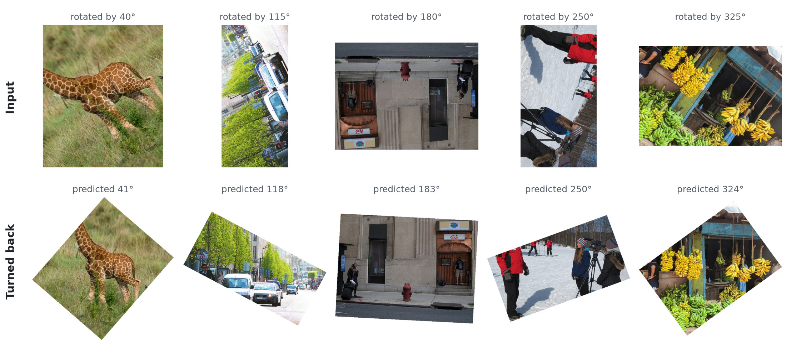

# Image Rotation Angle Estimation

[](https://arxiv.org/abs/2603.25351)
[](https://huggingface.co/spaces/maxwoe/image-rotation-angle-estimation)
[](https://huggingface.co/maxwoe/image-rotation-angle-estimation)
[](LICENSE)

Estimate how much an image has been rotated from its upright orientation.
No labels needed.
Includes pretrained models, an interactive demo, and training code for custom datasets.



## Quick Start

Requires Python 3.10+, CUDA 11.8+ recommended.
Clone the repo, then:

```bash
pip install -r requirements.txt
```

Download a pretrained checkpoint from the [HuggingFace Hub](https://huggingface.co/maxwoe/image-rotation-angle-estimation) and place it in `weights/`:

```
weights/
└── cgd_convnextv2_base_coco2017.ckpt
```

Then launch the demo:

```bash
python app.py  # opens Gradio UI at http://localhost:7861
```

For Python inference, see the [HuggingFace model card](https://huggingface.co/maxwoe/image-rotation-angle-estimation).

## Train on Your Own Images

No annotation files or labels needed.
Just a folder of correctly-oriented images.
The pipeline applies random rotations during training and learns to predict the applied angle.

```bash
python train.py --approach cgd --model-name convnextv2_base.fcmae_ft_in22k_in1k \
  --train-dir path/to/your/images --validation-split 0.1 \
  --batch-size 16 --mixed-precision --remove-traces \
  --test-dirs path/to/test/images --run-test --test-jpeg-quality 90
```

Keep `--remove-traces` whenever your images are stored in a lossy format such as JPEG.
Without it a model can read the applied angle from the rotated compression grid instead of the image content (see [Processing traces](#processing-traces-and-the-trace-free-protocol)).

### Evaluation only

```bash
python train.py --approach cgd --model-name convnextv2_base.fcmae_ft_in22k_in1k \
  --train-dir path/to/your/images --validation-split 0.1 \
  --batch-size 16 \
  --test-dirs path/to/test/images \
  --test-only --test-ckpt path/to/checkpoint.ckpt \
  --test-random-seed 0 --test-jpeg-quality 90
```

`--test-jpeg-quality 90` saves every rotated test view once as JPEG before it is shown to the model, which is how photos are stored in practice; leave it out to test on views that were never re-encoded.

For reproducing paper results on DRC-D and COCO, see [data/DATASETS.md](data/DATASETS.md).

## Results

Best results on DRC-D (mean over five training runs, conventional protocol):

| Method | Architecture | MAE (°) |
|---|---|---|
| CLS + CSL labels | MambaOut Tiny | 0.81 |
| CLS | EfficientViT-B3 | 1.23 |
| CGD | MambaOut Base | 1.24 |

Best configuration on COCO, CGD with ConvNeXt V2 Base, trained under the trace-free protocol and tested on 1,030 val images that are re-encoded once as JPEG at quality 90 after rotation (mean over three training runs):

| Training Data | MAE (°) | Prior model on the same views (OAD-360) |
|---|---|---|
| COCO 2014 | 3.88 | 6.09 |
| COCO 2017 | 3.76 | 6.09 |

The released checkpoint `cgd_convnextv2_base_coco2017.ckpt` is one of the three COCO 2017 runs (3.77° on re-encoded views, 4.45° on views that were never re-encoded).

The first arXiv version (v1) predates the trace-free protocol.
Its COCO numbers (for example 2.84° for CGD with MambaOut Base) were obtained under the conventional protocol, in which the models can read the rotated JPEG block grid.
Version 2 (17 November 2026) reports the results above.

## Methods

Five circular-aware approaches are implemented and benchmarked; the classification head can additionally be trained with Circular Smooth Labels (`--loss-type csl`), which removes its training instabilities on small datasets and yields the best DRC-D result.
Classification heads outperform regression heads in both data regimes.
At scale the three classification variants perform comparably, and CGD and CSL converged in every run.
See the [paper](https://arxiv.org/abs/2603.25351) for the full comparison.

| Abbreviation | Approach | Description |
|---|---|---|
| DA | Direct Angle | Scalar regression with circular loss |
| CLS | Classification | Angular binning (360 bins), cross-entropy or CSL labels |
| UV | Unit Vector | Regression on (cos θ, sin θ) |
| PSC | Phase-Shifting Coder | Frequency-domain encoding |
| CGD | Circular Gaussian Distribution | Probabilistic soft targets via KL divergence |

## Reproducing the paper's evaluation

- DRC-D grids: `compare.py` (per-method sweeps; `--extra-args` forwards options such as `--validation-split 0.2` or `--no-unit-regularization` to `train.py`).
- COCO cells: `eval/trace_coco_cell.sh` trains one cell under the trace-free protocol and runs its full evaluation (five test seeds on views without re-encoding and re-encoded at JPEG quality 95, 90 and 75, followed by the processing-trace checks); `eval/trace_matrix.sh` runs a list of cells on one backbone.
  A single checkpoint is evaluated across the five test seeds with `eval/eval_coco_ours.sh` (set `MODELS_FILE=` to a list of `approach|label|checkpoint` lines, `OUTPUT_JSON=` for the output and `TEST_JPEG_QUALITY=90` for re-encoded views).
- Test order: the order of the test images pairs them with the seeded test angles.
  It is pinned for the two test sets of the paper in `eval/test_order/`, so the evaluation gives the same numbers on every machine; other folders are listed alphabetically (`image_files.py`).
- Per-seed result files used in the paper are published.
  DRC-D: `eval/results/drcd/` (`base_grid_seeds.json` for the five base methods, `csl_sweep_seeds.json` for the CSL variant, and `valsplit20_seeds.json`, `uv_noreg_seeds.json`, `padding_cls_seeds.json`, `padding_cgd_seeds.json` for the ablations).
  COCO: `eval/results/trace_removal/` holds every model trained under the trace-free protocol in the four test forms (`*_seeds.json` without re-encoding, `*_q95_`, `*_q90_`, `*_q75_seeds.json` re-encoded) and the conventional-protocol models on re-encoded views (`published_coco2014_q90_seeds.json`, `published_coco2017_q90_seeds.json`); the `coco_*_seeds.json` files directly under `eval/results/` are the conventional-protocol models without re-encoding.
  Processing-trace checks: `eval/results/trace_audit/`.
  In the COCO files every statistic is computed over the whole test set.
  In the DRC-D files, `median`, `rmse`, `p90` and `p95` are averages over test batches of 16 images, as an earlier version of the test code computed them; they cannot be recomputed, because only the best run of each configuration was kept.
  The mean error, the accuracies and the AUC values of the DRC-D files are exact.
  `eval/paper_table.py` and `eval/significance_tests.py` regenerate the DRC-D table rows and the statistical tests and run with no arguments.
- Useful `train.py` options: `--early-stopping-min-delta` (improvement threshold for early stopping, 0.1 on COCO), `--rotation-mode pad` (padding control experiment), `--inference-method` (argmax or soft-argmax decoding), `--no-unit-regularization` (naive two-output regression baseline).

## Processing traces and the trace-free protocol

Training and test views for this task are made by rotating an upright photo and cropping the largest inscribed rectangle.
Photos are stored as JPEG files, and decoding one leaves the 8×8 block grid of the codec in its pixels.
Rotating the decoded photo turns this grid together with the content, so every view carries the applied angle modulo 90° in a faint periodic pattern that has nothing to do with what the image shows.

Models trained this way on COCO learned to read it, the 360-bin classification heads far more than the regression heads.
The two legacy checkpoints on the Hub are examples: saving each COCO test view once as JPEG at quality 90 takes the COCO 2017 CGD model with MambaOut Base from 2.84° to 24.45° MAE, with about three quarters of its predictions snapping to a multiple of 90°.
This sensitivity was first reported by ORTUS AI in September 2026.
It is a property of the common rotate-and-crop protocol, not of one method.

### Training without the cue

`--remove-traces` trains and validates under the trace-free protocol of the paper: every view is re-encoded once as JPEG after rotation and cropping, at a quality drawn from 40 to 90, and the interpolation kernel of the rotation is drawn at random (`rotation_utils.TraceRemoval`).
The re-encoding overlays a grid that is aligned with the image frame, as any camera or web pipeline produces, and that carries no information about the angle.
Validation views use a per-index seed so early stopping is stable.

```bash
# the released model: CGD + ConvNeXt V2 Base on COCO 2017 (see data/DATASETS.md for the folders)
python train.py --approach cgd --model-name convnextv2_base.fcmae_ft_in22k_in1k \
  --train-dir data/datasets/train_coco_2017 --validation-split 0.1 --batch-size 16 \
  --early-stopping-min-delta 0.1 --remove-traces \
  --test-dirs data/datasets/test_coco --run-test --test-jpeg-quality 90
```

Further options change the recipe: `--remove-traces-jpeg lo,hi` and `--remove-traces-jpeg-prob` (quality range and share of re-encoded views), `--remove-traces-scale lo,hi` (random downscale before the re-encode), `--remove-traces-blur lo,hi` (Gaussian blur before the re-encode), `--remove-traces-resamplers`, and `--rotation-mode crop_fixed` (an angle-independent crop as a control for the field-of-view coupling of the max-area crop).

### Checking a trained model

A low error is not proof that a model reads the content.
Four checks make the question measurable for any checkpoint:

```bash
# Test views without re-encoding against the same views saved once as JPEG
python eval/jpeg_gap.py --approach cgd --ckpt path/to/checkpoint.ckpt \
  --test-dir data/datasets/test_coco --seeds 0,1,2,3,4 --conditions clean,jpeg90 --order pinned

# Content-free probe: noise textures without any orientation, with and without a JPEG grid.
# Anything above chance (11.1% within 5° modulo 90°) is trace reading. Exit code 1 if a criterion fails.
python eval/grid_probe.py --approach cgd --ckpt path/to/checkpoint.ckpt --n 1000
python eval/grid_probe.py --approach cgd --ckpt path/to/checkpoint.ckpt --n 1000 \
  --conditions lossless/jpeg90,jpeg95/jpeg90,jpeg75/jpeg90

# Cue conflict: a grid stamped at an offset from the content; reports which of the two the model follows
python eval/cue_conflict.py --approach cgd --ckpt path/to/checkpoint.ckpt

# On the test photos: precision drawn from a rotated source grid, and from the interpolation pattern
python eval/source_grid_reliance.py --models models.txt --out-dir eval/results/trace_audit/source_grid_reliance
python eval/rotation_residue.py --models models.txt --out-dir eval/results/trace_audit/rotation_residue
```

`models.txt` holds one `approach|tag|checkpoint` line per model.
The released checkpoint passes these checks except for one of the seven probe conditions, which it misses by 0.1 point (see the model card).

## Citation

```bibtex
@misc{woehrer2026irae,
  title={Image Rotation Angle Estimation: Five Circular-Aware Methods Across Sixteen Architectures},
  author={Woehrer, Maximilian},
  year={2026},
  eprint={2603.25351},
  archivePrefix={arXiv},
  primaryClass={cs.CV},
  url={https://arxiv.org/abs/2603.25351}
}
```
