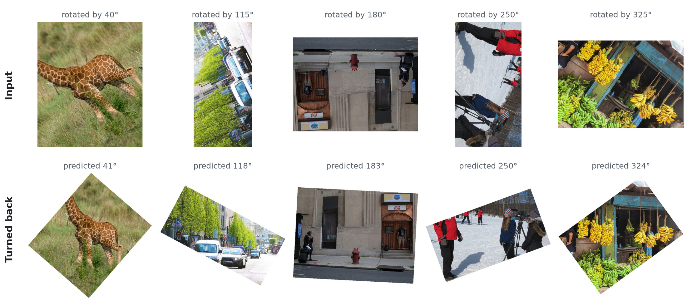

# Image Rotation Angle Estimation

**[Try the interactive demo](https://huggingface.co/spaces/maxwoe/image-rotation-angle-estimation)** | **[GitHub](https://github.com/maxwoe/image-rotation-angle-estimation)** | **[Paper](https://arxiv.org/abs/2603.25351)**

Estimates by how many degrees a photo is rotated away from upright, anywhere in the full 360° range, so that it can be turned back.
On COCO test photos the mean absolute error is 3.77° and 97% of the predictions are within 10°.



The model is a **ConvNeXt V2 Base** backbone with a **Circular Gaussian Distribution (CGD)** head.
It outputs a probability distribution over 360 one-degree bins and returns the most probable angle, so there is no discontinuity at 0°/360°.

## Usage

```bash
pip install torch torchvision pytorch-lightning timm huggingface_hub pillow numpy loguru
```

```python
import sys
from huggingface_hub import snapshot_download
from PIL import Image

# The inference code is part of this repository
sys.path.insert(0, snapshot_download("maxwoe/image-rotation-angle-estimation", allow_patterns=["*.py"]))
from model_cgd import CGDAngleEstimation

model = CGDAngleEstimation.from_pretrained("maxwoe/image-rotation-angle-estimation")

image = Image.open("your_image.jpg")
angle = model.predict_angle(image)  # degrees in [0, 360), counter-clockwise
print(f"Predicted rotation: {angle:.1f}°")

upright = image.rotate(-angle, expand=True)  # turn the image back
```

- `predict_angle` accepts a PIL Image, a numpy array or a file path.
- The angle is measured counter-clockwise: 90° means the image was turned a quarter turn to the left, and rotating it by `-angle` restores it.
- Inference takes about 0.3 seconds per image on a CPU; call `model.to("cuda")` to use a GPU.

## Evaluation

1,030 COCO test photos, each rotated by a random angle and cropped to the largest rectangle that contains no border; means over five sets of random angles.
In the first column the rotated image is saved once as JPEG (quality 90) before the model sees it, which is how rotated photos exist in practice.
In the second column it is passed to the model without ever being saved.

| Metric | Saved as JPEG after rotation | Never saved after rotation |
|---|---|---|
| Mean absolute error | 3.77° | 4.45° |
| Median error | 1.12° | 1.33° |
| Within 2° | 71.4% | 64.5% |
| Within 5° | 93.7% | 89.7% |
| Within 10° | 97.4% | 95.8% |
| 90th percentile error | 5.45° | 6.74° |
| 95th percentile error | 14.62° | 17.10° |
| RMSE | 9.76° | 11.19° |

The error is nearly the same across JPEG quality settings (3.87° at quality 95, 3.75° at quality 75).
The checkpoint is one of three training runs of this configuration, which reach 3.70°, 3.77° and 3.81° (mean 3.76°).
The strongest earlier model, OAD-360, reaches 6.09° on the same images.

## Limitations

- **Photos only.** The model was trained and tested on everyday photos (COCO). Documents, scans, screenshots, drawings, aerial and medical images were not evaluated.
- **Ambiguous images.** Close-ups, textures and symmetric scenes have no clear "up". More than half of the large errors are confusions by 90° or 180° on such images.
- **Central square.** The image is resized so that its shorter side is 224 pixels and the central 224 x 224 square is used. In a very elongated image the model does not see the ends.
- **Images never saved after rotation.** Rotations that are applied in memory or kept in a lossless format are slightly outside the training distribution, which is why the error is a little higher in the second column above.
- **No confidence value.** `predict_angle` returns an angle only, and the probabilities of the model were not evaluated as a measure of confidence.

## Checks for Processing Traces

A model for this task can score well without looking at the image content: when a decoded JPEG photo is rotated, the 8x8 block grid of the JPEG codec turns with it and reveals the angle.
This model was trained under the trace-free protocol of the paper, in which every training image is saved as JPEG after rotation, and it was then tested for reliance on such traces:

- **Content-free probe.** Noise images without any orientation, with and without a JPEG grid, are rotated and shown to the model, which should then be at chance. It meets both criteria of the probe in six of seven conditions. In the seventh, 14.0% of its predictions land within 5° of the grid angle (chance: 11.1%); the upper confidence bound of this excess is 5.1 points, against a limit of 5 points fixed in advance, so it misses that criterion by 0.1 point.
- **Cue conflict.** When a grid is stamped at an angle that contradicts the content, the model follows the content; the grid attracts at most 6% of the predictions.
- **Test photos.** A rotated source grid changes the share of predictions within 2° by -0.4 points, and the interpolation pattern of the rotation by 1.5 points; both are inside the limit of 5 points.

The scripts for these checks are in the GitHub repository.

## Checkpoints

| Checkpoint | Training data | Error, saved as JPEG after rotation | Error, never saved after rotation |
|---|---|---|---|
| `cgd_convnextv2_base_coco2017.ckpt` (default) | COCO 2017 | 3.77° | 4.45° |
| `cgd_mambaout_base_coco2017.ckpt` (legacy) | COCO 2017 | 24.45° | 2.84° |
| `cgd_mambaout_base_coco2014.ckpt` (legacy) | COCO 2014 | 21.05° | 3.71° |

**Do not use the legacy checkpoints for real photos.**
They were trained on images that were rotated but never saved again, and they learned to read the rotated JPEG grid described above.
That makes them very precise on images that were never saved after rotation and unreliable on everything else.
They remain available so that earlier results stay reproducible, and can be loaded with `from_pretrained(..., model_name="cgd_mambaout_base_coco2017.ckpt")`.

## Model Details

- **Method:** Circular Gaussian Distribution (CGD), 360 bins, sigma = 6.0°, KL divergence against soft Gaussian labels, angle decoded by argmax
- **Backbone:** ConvNeXt V2 Base (`convnextv2_base.fcmae_ft_in22k_in1k`), pretrained on ImageNet, fine-tuned end to end
- **Size:** 88 million parameters, 352 MB (weights only)
- **Input:** 224 x 224 pixels, ImageNet normalization
- **Training data:** COCO 2017 train split without the test images (117,372 images), 10% held out for validation
- **Training images:** rotated by a random angle in [0°, 360°), cropped to the largest rectangle without border, saved as JPEG at a random quality between 40 and 90; the interpolation method of the rotation is drawn at random
- **Optimizer:** AdamW, learning rate reduced on plateau, early stopping

## Paper and Citation

The method comparison behind this model is described in [Image Rotation Angle Estimation: Comparing Circular-Aware Methods](https://arxiv.org/abs/2603.25351).
The current arXiv version predates the trace-free protocol: its COCO results (for example 2.84°) are those of the legacy checkpoints.
An updated version is in preparation.

```bibtex
@misc{woehrer2026irae,
  title={Image Rotation Angle Estimation: Comparing Circular-Aware Methods},
  author={Woehrer, Maximilian},
  year={2026},
  eprint={2603.25351},
  archivePrefix={arXiv},
  primaryClass={cs.CV},
  url={https://arxiv.org/abs/2603.25351}
}
```

## License

MIT
